

# Viacheslav Olishchuk

### I build websites and business systems (CRM · ERP · WMS) tailored to how your company actually works

From a simple business website to sales, warehouse and finance in one system.
Based in Lviv, Ukraine · working with clients worldwide

---

## 💼 What I do

| Service | Best for | What you get |
|---|---|---|
| 🌐 **Template-based website** | small businesses, freelancers, local services | fast launch, mobile-friendly, basic SEO, contact form |
| 🎨 **Custom website** | companies, manufacturers, brands | unique design, product catalog, multilingual, easy-to-use admin panel |
| 🛒 **Catalog / B2B website** | manufacturers, wholesalers, exporters | product catalog, quote requests, SEO for every product page |
| 📊 **CRM system** | sales teams, real estate, service businesses | pipeline, clients, deals, payments, access roles, analytics |
| 🏭 **ERP system** | manufacturing, distribution | purchasing, production, finance and inventory in one place |
| 📦 **WMS (warehouse system)** | warehouses, logistics, e-commerce | receiving, putaway, picking, shipping, real-time stock |
| ⚙️ **Automation & integrations** | any business | API integrations, import/export, reports, scripts, bots |

> Not sure whether you need a website, a CRM or something custom? Tell me how your business runs today, and I'll suggest the right solution.

---

## 🚀 Featured projects

### 🫐 Galychanka Farm — website for a frozen berry producer

<a href="https://galychanka.com/">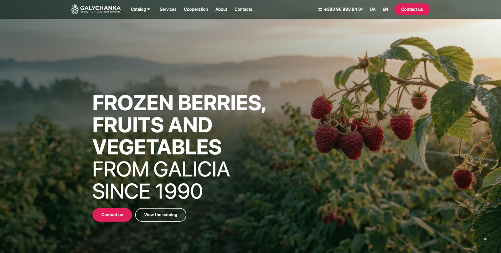</a>

B2B corporate website for a family farm from the Lviv region (est. 1990) that produces frozen berries, fruit and vegetables and offers blast freezing, cold storage and packing services.

- **Product catalog** — 20+ products across 4 categories (cultivated and wild berries, fruit, vegetables), each with its own page
- **Service pages** — blast freezing, cold storage, sorting, packing, private label
- **Ukrainian and English versions** — for the domestic market and export buyers
- **SEO and social sharing** — meta tags, Open Graph previews, search-friendly URL structure
- **Responsive design** in the company's brand style

🔗 **[galychanka.com](https://galychanka.com/)**

---

### 🏗️ DevelopmentCRM — CRM for real estate developers

<a href="https://www.developmentcrm.com/">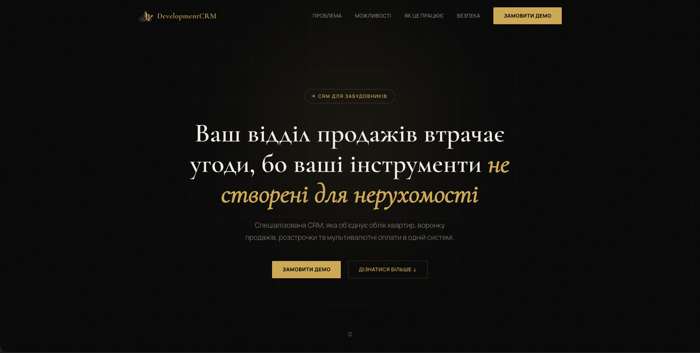</a>

A specialized CRM for selling new-build real estate: apartment inventory, sales pipeline, installment plans and multi-currency payments in one system. I built both the product itself and its marketing website.

<table>
<tr>
<td width="50%">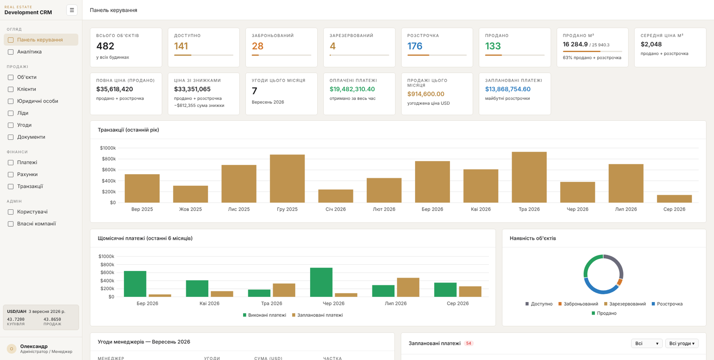</td>
<td width="50%">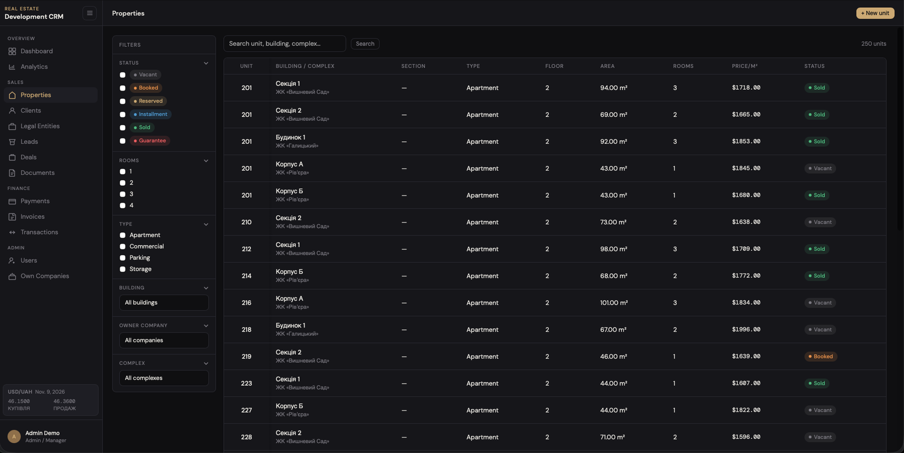</td>
</tr>
<tr>
<td align="center">Admin dashboard: KPIs, sales, collected payments</td>
<td align="center">Unit inventory with live statuses</td>
</tr>
<tr>
<td width="50%">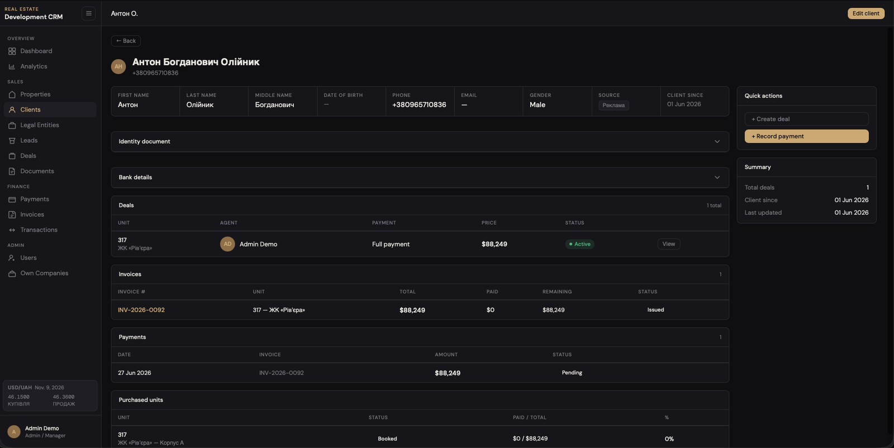</td>
<td width="50%">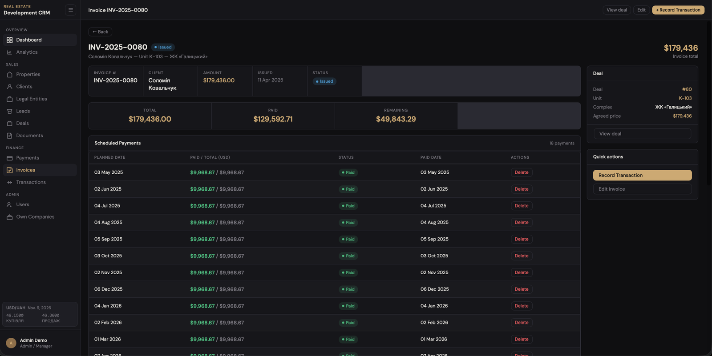</td>
</tr>
<tr>
<td align="center">Deal card: client, unit, agent, invoices</td>
<td align="center">Installment schedule: paid and open payments</td>
</tr>
<tr>
<td width="50%">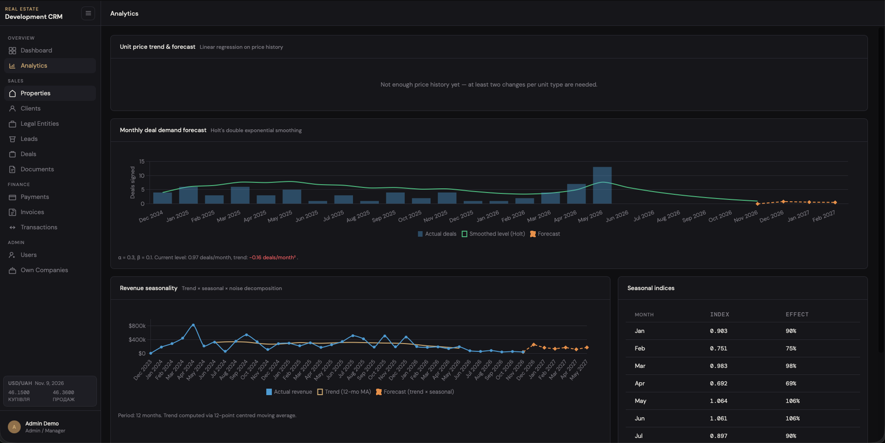</td>
<td width="50%">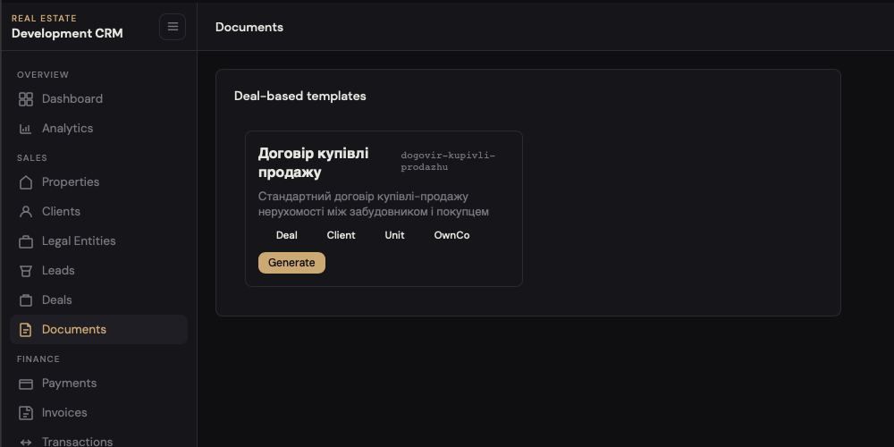</td>
</tr>
<tr>
<td align="center">Sales forecasting</td>
<td align="center">Contract generation from templates</td>
</tr>
</table>

#### Core modules
- **Property inventory** — complexes → buildings → units, pricing, discounts, unit documents and full price history
- **Sales pipeline** — leads, clients and deals linked to specific units and sales agents
- **Finance** — installment plans, payment schedules, invoices and transactions in UAH / USD / EUR
- **Documents** — sales contracts generated from Word templates
- **Analytics** — role-based dashboards, revenue, conversion and sales forecasts
- **Users & access** — 4 roles with page- and form-level permissions

#### By the numbers
- **6** business modules — inventory, sales, finance, documents, analytics, access control
- **24** data entities — from complexes and units to invoices, transactions and exchange rates
- **4** user roles, each with its own dashboard
- **3** currencies (UAH, USD, EUR) consolidated into one USD report
- **6** unit statuses tracked from "vacant" to "sold"
- **205** automated tests run before every deploy

#### Highlights
- **Isolated deployment** — a dedicated server and database per company, so your data is never shared.
- **FIFO payment allocation** — incoming money closes the oldest invoices first; overdue amounts are always visible.
- **Multi-currency finance** — exchange-rate snapshots turn UAH/USD/EUR sales into one comparable report.
- **Leads API** — your website and listing portals push leads straight into the CRM, tagged by source.
- **CSV import** — load a whole building's units in minutes instead of typing them in.
- **Automated delivery** — every update is tested and deployed by CI/CD, with HTTPS out of the box.

#### More features
- **Contract generator** — Word templates filled from deal data, amounts written out in words.
- **Installment configurator** — build, tweak and save a payment schedule for any deal in two steps.
- **Sales forecasting** — trend, Holt and seasonal forecasts on the analytics page.
- **Excel export** — payments and transactions, respecting your filters.
- **Price & transaction history** — every price change and payment edit is logged.
- **Companies & co-buyers** — deals with legal entities and multiple parties.
- **Ukrainian / English UI** and light/dark theme.

#### Tech stack
Python 3.13 · Django 5.2 · PostgreSQL 16 · Redis 7 · Django Templates + vanilla JS · Chart.js · openpyxl · docxtpl · Cloudflare R2 (S3) · Docker Compose · Caddy · Gunicorn · GitHub Actions

🔗 **[developmentcrm.com](https://www.developmentcrm.com/)** · demo available on request

---

### 📦 Berry WMS — warehouse system for a frozen berry cold store

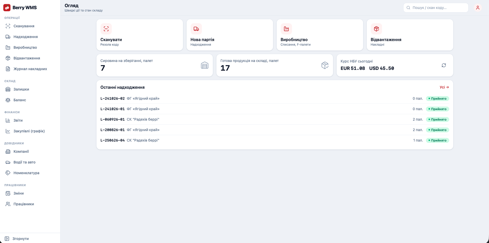

Live stock by pallet and status

A warehouse management system for a frozen berry cold store that handles both its own purchased berries and customer-owned berries it freezes and processes as a service. Every lot and pallet is tracked from intake weighing through freezing and processing to shipment, so the business always knows what is in stock, who owns it and where it came from. Warehouse staff work on phones and tablets with QR scanning; the office uses the browser for documents, balances, reports and payroll.

<table>
<tr>
<td width="50%">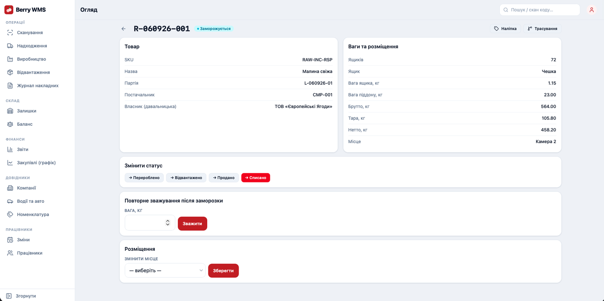</td>
<td width="50%">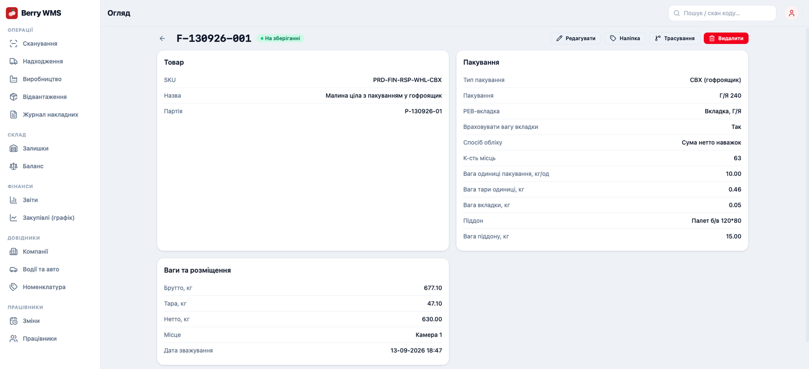</td>
</tr>
<tr>
<td align="center">Full pallet traceability in seconds</td>
<td align="center">Receiving with automatic weight control</td>
</tr>
<tr>
<td width="50%">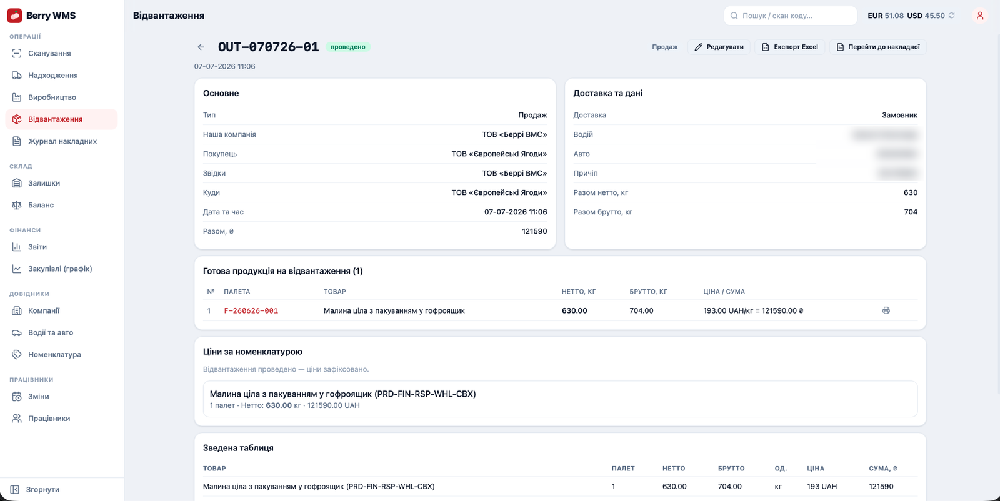</td>
<td width="50%">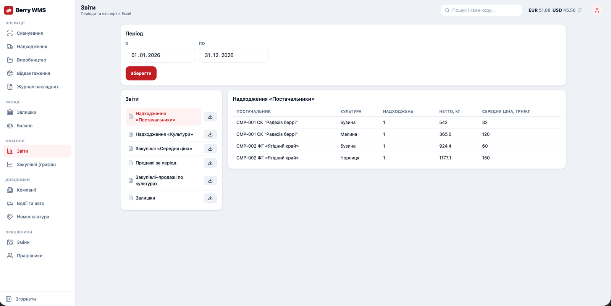</td>
</tr>
<tr>
<td align="center">Shipping with QR scan and invoices</td>
<td align="center">Purchase analytics and Excel reports</td>
</tr>
</table>

#### Key features
- **Receiving** — supplier lots and pallets with gross, tare and net weight, reusable templates, a unique ID and printable QR label for every pallet.
- **Freezing & loss control** — pallets are reweighed after freezing and the loss is calculated in kg and %, so weight losses are visible and justified.
- **Production** — raw pallets go into production batches oldest-first and come out as finished-goods pallets, with the full raw-to-finished chain recorded.
- **End-to-end traceability** — scan any pallet to see its history back to the supplier lot and forward to the customer shipment. Ready for food-safety audits.
- **Shipping** — sales, transfers and returns after processing; pallets added by QR scan, packaging counted, invoice generated on posting.
- **Documents** — incoming and outgoing invoice journal with print, PDF and Word export, Excel waybills and per-lot pallet breakdowns.
- **Stock & balances** — live stock by status and SKU, balances by warehouse, company and service customer.
- **Reports & finance** — receiving, average purchase price, sales and trade by crop, purchase dynamics chart; UAH/USD/EUR at the official National Bank of Ukraine rate; everything exports to Excel.
- **Customer-owned goods (tolling)** — own and customer-owned goods are tracked separately, so every customer gets back exactly their own product.
- **Staff & logistics** — employees, work shifts with hours and pay, drivers and refrigerated trucks.

#### By the numbers
- **12** backend modules
- **19** database entities
- **8** pallet lifecycle statuses, from "received" to "shipped" or "written off"
- **11** business reports and balances with Excel export
- **6** document outputs (invoice print / PDF / Word, Excel waybill, lot breakdown, QR label)
- **133** automated tests

#### Highlights
- **Every weight checked and derived** (net = gross − tare, automatic freezing loss) → no manual arithmetic, no weight disputes with suppliers.
- **Oldest-first pallet selection** → stock rotates properly and old raw material doesn't sit forgotten in the freezer.
- **Lot-to-shipment traceability** → recall or audit questions answered in seconds.
- **Transactional posting with strict checks** → no empty or double shipments, balances always consistent.
- **Built-in National Bank of Ukraine exchange rates** → multi-currency amounts always at the official rate.
- **Mobile-first PWA with camera QR scanning and an audit trail** → who created each record and when, plus active sessions users can revoke.

#### Tech stack
Python 3.13 · Django 6 + Django REST Framework · JWT · React 19 + Vite · PWA · Tailwind CSS 4 · PostgreSQL 16 · Docker Compose · Caddy · GitHub Actions · openpyxl · ReportLab · python-docx

🔒 Private system, built for a client · demo on request

---

## 🔄 How we work together

1. **Discovery call** — we go through your business and goals (free)
2. **Proposal** — scope, timeline and price agreed in writing
3. **Design / prototype** — you see how it will look before development starts
4. **Development** — regular demos so you always see progress
5. **Launch** — deployment, data migration and team onboarding
6. **Support** — improvements and new features after launch

## 🛠️ Tech stack

Background in QA automation, so quality is built in from day one: automated tests and CI/CD on every project (205 tests in DevelopmentCRM, 133 in Berry WMS).

---

### Have a project in mind? Let's talk.

📫 **[olishchuk.vyacheslav@gmail.com](mailto:olishchuk.vyacheslav@gmail.com)** · 💬 **[Telegram](https://t.me/olishchuk)**

I reply within one business day

